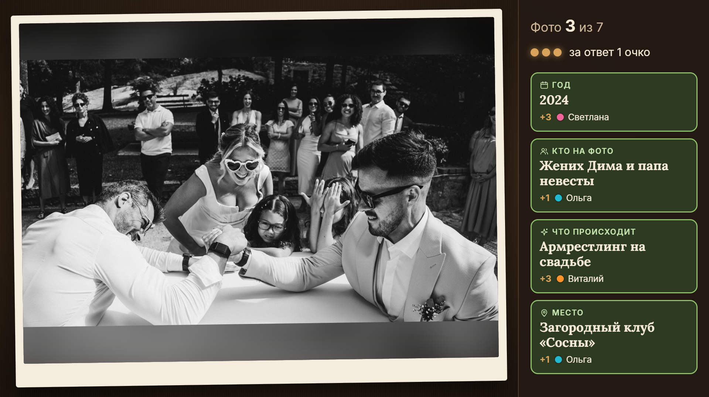

# Стоп-кадр

«Стоп-кадр» — командная игра для ведущих мероприятий. На большом экране
появляется фрагмент фотографии. Команды угадывают, что осталось за кадром,
а ведущий постепенно показывает больше, раскрывает ответы и начисляет очки.

## Где играть

- На корпоративе можно собрать раунды из фотографий команды и офиса.
- На свадьбе или юбилее — показать снимки из семейного архива.
- Для квиза, вечеринки или школьного праздника — подготовить подборку по теме.

В игре есть демо-набор. Свои фотографии и ответы можно добавить во встроенном
редакторе. Для экрана гостей можно выбрать одну из четырёх тем. После игры
ведущий может запустить слайд-шоу с выбранными фотографиями и музыкой.

## Что понадобится

- Ноутбук с Windows x64 или Mac с процессором Apple Silicon либо Intel.
- Телевизор, проектор или второй монитор для экрана гостей.
- Телефон для браузерного пульта, если ведущему удобнее управлять игрой из зала.
  Подключите телефон и ноутбук к одной локальной сети.

## Как начать

1. В разделе «Скачать» на сайте игры выберите установщик для своего компьютера.
   Для Windows используется файл `.exe`, для macOS — образ `.dmg`.
2. Откройте игру, выберите демо-набор или подготовьте раунды в редакторе.
3. Выведите экран гостей на телевизор или проектор. При необходимости
   подключите телефон по QR-коду в интерфейсе ведущего.

Если у вас есть лицензионный ключ, используйте его в установленной игре.
Для онлайн-активации понадобится интернет. Игровая сессия проходит в локальной сети.
